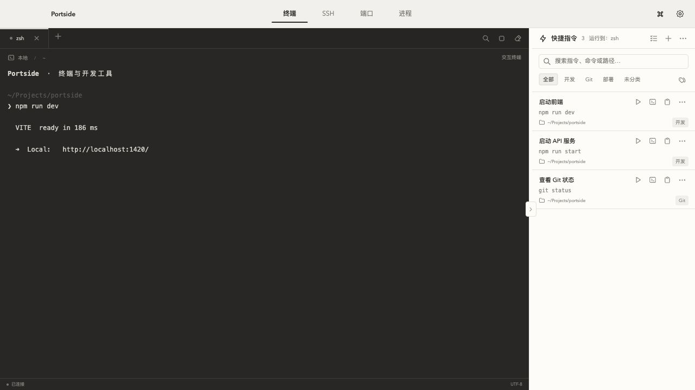
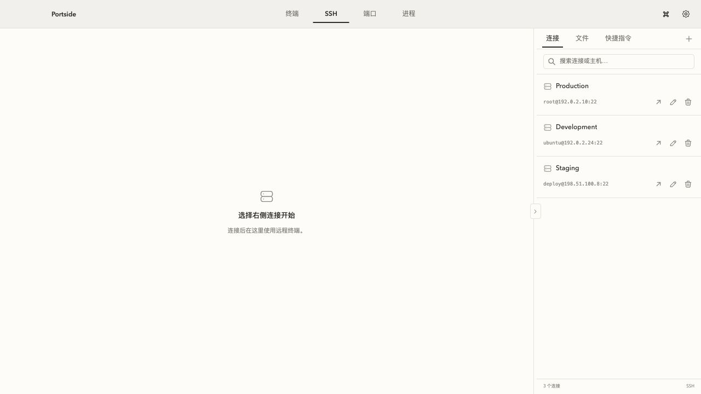
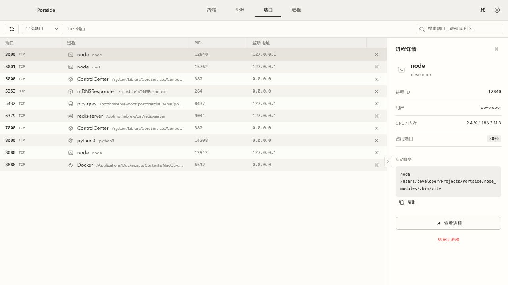
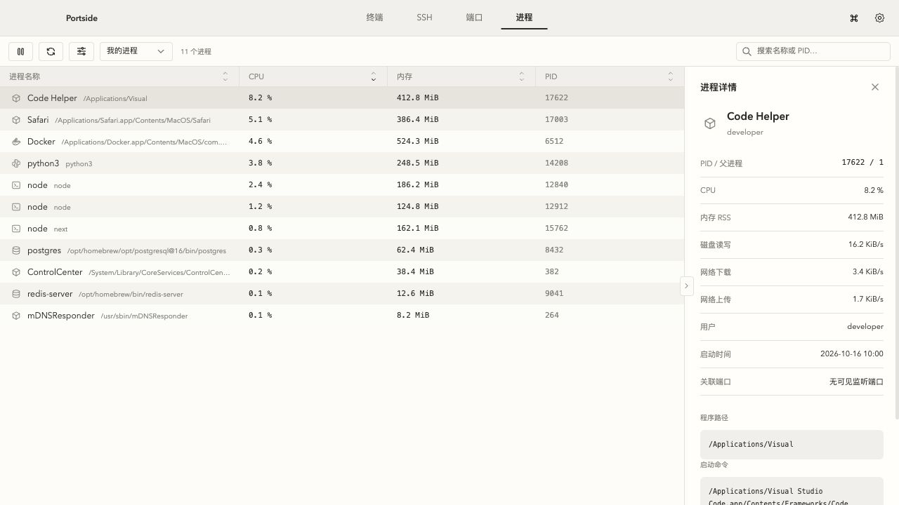
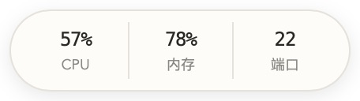

# Portside

一个简洁的 macOS 开发工作台，把终端、SSH、端口和进程管理放在同一个窗口里。

[下载最新版](https://github.com/tingxi8087/portside/releases/latest) · [开发指南](doc/开发指南.md) · [反馈问题](https://github.com/tingxi8087/portside/issues)

> 界面截图使用示例命令、服务器和进程数据。安装后的桌面应用读取真实系统数据，SSH 连接需自行配置。

## 安装

1. 在 [Releases](https://github.com/tingxi8087/portside/releases/latest) 下载 `Portside_<版本>_aarch64.dmg`。
2. 打开 DMG，将 **Portside** 拖入「应用程序」，再从「应用程序」启动。
3. 当前安装包适用于 **Apple Silicon（M 系列芯片）**，尚未提供 Intel 版本。

当前版本未经过 Apple Developer ID 签名与公证，首次打开可能受到 macOS 安全检查限制。确认下载来自本仓库后，可按系统提示在「系统设置 → 隐私与安全性」中允许打开。

## 终端与快捷指令

打开应用默认进入终端，直接输入命令即可使用本机 Shell。点击标签栏的 **＋** 新建终端，双击标签重命名；工具栏可搜索输出、中断任务或清屏。切换页面会保留会话。本地终端关闭前，检测到仍有任务运行时会提示确认。

右侧是快捷指令库：

- 点击 **＋** 填写名称、命令和可选工作目录；每条指令最多一个标签。
- **运行**：在当前选中的终端里执行。目录留空沿用当前目录；指定目录则先切换目录，再执行命令。
- **在新会话运行**：新建一个终端再执行。未指定目录时从默认主目录开始。
- **复制命令**：只将命令文本复制到剪贴板。**更多 → 创建副本** 则复制一条快捷指令，方便修改。
- 按名称、命令、路径搜索，或按标签筛选；进入多选后可批量删除、修改标签和导出。
- 面板右上角 **更多** 可导入 JSON、导出全部或当前筛选结果；导入先预览，重复项会跳过，同名但内容不同的指令创建副本。导入不会执行命令。

本地终端和 SSH 共用同一套快捷指令。在 SSH 页面运行时，目标是远程会话，指定的目录也对应远程服务器。

## SSH 与远程文件

1. 切换到 **SSH**，点击右侧连接列表的 **＋**。
2. 填写连接名称、主机、用户名、端口和认证方式。支持密码、SSH 私钥及私钥口令、SSH Agent。
3. 可先 **测试连接**，保存后点击连接图标打开远程终端。连上后，该图标变为断开连接。
4. 首次连接时核对并确认服务器主机指纹。服务器重装等情况导致指纹变化时，会显示新旧指纹，确认无误后再更新信任。

连接后，右侧切换到 **文件** 即可浏览 SFTP 目录：单击目录进入，单击文本文件在独立弹窗中打开并编辑、保存。文本编辑支持不超过 1 MB 的 UTF-8 文件，其他文件可下载到本地打开。

文件面板还支持上传、下载、拖放上传、新建目录、重命名、删除及传输取消。同名覆盖会提示确认，目录仅支持删除空目录。远程文件发生变化时，保存前会检查冲突。

## 端口

查看本机 TCP 监听端口和 UDP 绑定端口，按端口、进程名或 PID 搜索，也可筛选本机或非回环地址。

- 单击一行，在右侧查看占用进程的详情。
- 点击行末的 **×** 结束进程，或右键选择 **查看进程 / 结束进程**。
- 结束进程会同时释放该进程占用的其他端口。先发送正常终止信号，仍未退出时可确认强制结束。

## 进程

查看进程的 CPU、内存及 PID；点击「显示更多列」可查看磁盘和网络。点击表头排序，支持搜索、筛选我的进程 / 全部进程、暂停刷新。

单击一行查看右侧详情，右键可 **结束进程**。

CPU 显示该进程占整机的比例，与悬浮球使用相同口径：例如 10 核机器占满一核约为 10%。内存为 RSS；磁盘、网络显示采样间隔内的速率。首个样本或权限不足时显示 `—`。筛选范围、权限和采样时间不同，列表合计不一定等于悬浮球的当前读数。

## 悬浮球与设置

在右上角 **设置** 中按需配置：

- **外观**：浅色 / 深色 / 跟随系统，独立终端配色，自定义背景图片、透明度与模糊。
- **悬浮球**：从 CPU、内存、下载、上传、监听端口中勾选 **1–3 个指标**，可调整顺序。默认关闭。
- **通用**：开机自动启动，默认不勾选。与悬浮球同时开启时，登录后只显示悬浮球。

悬浮球单指标为圆形，多指标为胶囊形。拖动可调整位置并吸附屏幕边缘，点击恢复主窗口；右键可修改显示内容、隐藏或退出。

右侧面板可拖动分隔线调整宽度，点击中间箭头或按 `⌘B` 收起 / 展开。

## 快捷键

| 快捷键 | 操作 |
| --- | --- |
| `⌘1` | 终端 |
| `⌘2` | SSH |
| `⌘3` | 端口 |
| `⌘4` | 进程 |
| `⌘B` | 展开 / 收起当前页右侧面板 |
| `⌘K` | 快速搜索页面、连接和快捷指令 |
| `⌘H` | 隐藏应用 |

页面切换和面板快捷键在终端获得焦点时也可用；打开弹窗时暂停响应，避免切换后台页面。

点击窗口红色关闭按钮会隐藏主界面并保留会话；开启悬浮球时仍可通过它恢复窗口。需要彻底退出时，从 Dock 图标右键选择 **退出**。

## 数据保存

连接资料、快捷指令和外观设置保存在本机，重启后保留；终端进程和文件传输不会跨退出恢复。

- 配置目录：`~/Library/Application Support/com.portside.desktop/`。
- 普通配置：`workspace.json`，服务器主机指纹另行保存。
- 选择「保存凭据到本机（明文）」后，SSH 密码 / 私钥口令保存在 `ssh-credentials.json`；文件权限为 `0600`，文件内容仍可直接读取。未勾选时只在本次运行中记住。
- 快捷指令导出只包含名称、命令、目录和标签，不包含 SSH 连接或凭据。命令文本中自行填写的敏感内容也会原样导出。

需要从源码运行、打包或参与开发，请看 [开发指南](doc/开发指南.md)。
